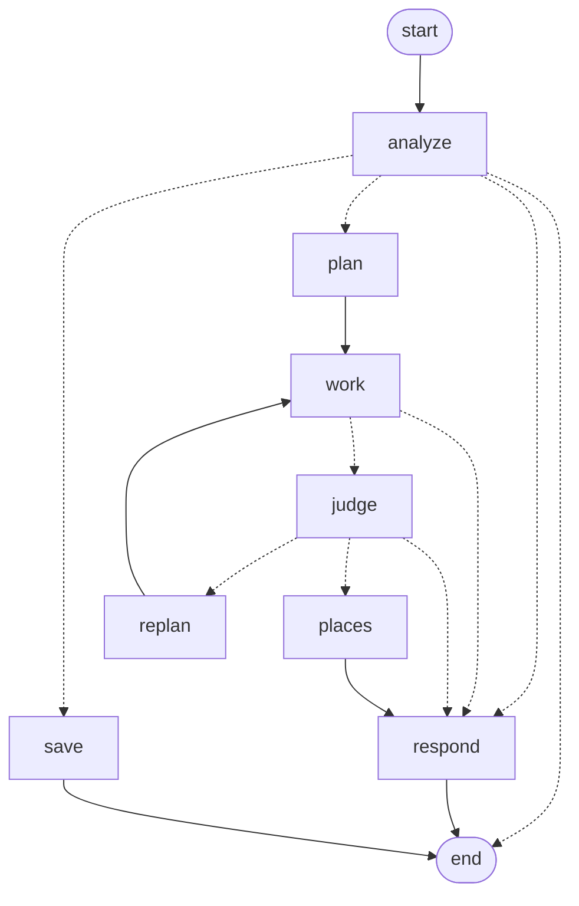

# 2. Agent 설계 문서

## 1. 전체 구조

```
사용자 ──HTTP──▶ FastAPI ──▶ 메인 Agent (LangGraph) ──emit──▶ 이벤트 버스 ──▶ 로깅 Agent ──▶ SQLite(event_log)
                                │                                               
                                └─ Tool 3종 (파고 · 해변 날씨 · 장소 검색)         계획(plans) ◀── save 노드
```

- 메인 Agent는 **이벤트를 `emit`만** 합니다. 누가 듣는지 모르고, 로깅 Agent가 없어도(또는 실패해도) 동작합니다.
- **LLM은 analyze 한 곳에서만** 호출합니다. 판정·재계획·답변은 규칙과 코드입니다.

## 2. 실행 그래프



(`python -m scripts.print_graph` 출력에서 시작/종료 표기만 줄였습니다. 점선은 조건 분기입니다.)

## 3. 실행 단계와 입출력

| 단계 | 하는 일 | 입력 | 출력(상태에 기록) | LLM |
|---|---|---|---|---|
| analyze | 의도 분류, 조건 추출, 조건 병합 | 사용자 메시지, 현재 조건, 최근 대화 | `intent`, `intent_reason`, `conditions`, `changed_conditions` | ✅ (유일) |
| plan | 조건 → Tool 작업 목록 | conditions | `task_queue`, `tried_regions` | ✕ |
| work | Tool 순차 실행, 캐시 재사용, 오류 처리 | task_queue, tool_cache | `tool_cache`, `tool_log`, (치명 오류 시) `fatal_error` | ✕ |
| judge | 스팟별 판정·순위, 후보 유무 판단 | tool_cache, conditions | 후보/제외 목록, 경고 | ✕ |
| replan | 다음 지역 선택, 작업 목록 재생성 | tried_regions, conditions | `task_queue`, `replan_count` | ✕ |
| places | (요청 시) 1위 스팟 주변 장소 검색 | 후보 1위, `wants_places` | 장소 목록 | ✕ |
| respond | 답변 문장 생성(출처·면책 포함) | 위 결과 전부 | `answer`, `last`(마지막 추천) | ✕ |
| save | 직전 추천을 계획으로 저장 | `pick`, `last` | `plans` 행, 저장 확인 답변 | ✕ |

### 의도(intent)별 경로

| intent | 경로 |
|---|---|
| plan_request / modify_request | analyze → plan → work → judge → (replan → work …) → [places] → respond |
| save_plan | analyze → save |
| need_info | analyze → END (analyze가 되묻는 답변을 직접 채움) — Tool 호출 없음 |
| out_of_scope | analyze → END (안내 답변을 직접 채움) — Tool 호출 없음 |
| LLM 호출 실패 | analyze → respond (`fatal_error: LLM_ERROR`, 다시 시도 안내) |

## 4. 계획 수립과 재계획 판단 조건

### 4-1. 계획 수립

- 날짜가 없으면 계획하지 않고 되묻습니다(날짜는 판단의 필수 조건).
- 지역을 말하지 않았으면 기본 지역(양양)으로 시작하고 **그 가정을 답변에 밝힙니다**(`region_assumed`).
- Tool 인자의 시각(`start_time`, `end_time`)은 **사용자가 말한 경우에만** 넣고, 아니면 Tool 기본값(06:00~12:00)을 씁니다.
- `end_by`(“몇 시까지 나와야 해”)가 있으면 `effective_end`로 조회 끝 시각을 늘리고, 판정 시 `latest_start = end_by − SESSION_HOURS(2시간)`을 안내합니다.
- 작업 목록은 항상 `get_wave_forecast` → `get_beach_weather` 순서입니다. 해변 날씨는 파고 결과로 얻은 후보만 조회합니다(`chain_beach_args`).

### 4-2. 재계획 조건

재계획은 **아래를 모두 만족할 때만** 합니다.

1. 판정 결과 후보(적합·주의)가 0개
2. 치명 오류(`NON_RETRYABLE`: 키 누락·인증 오류·잘못된 입력)가 아님 — 이 경우 work 직후 바로 respond로 갑니다
3. 재계획 횟수가 `MAX_REPLAN = 3` 미만
4. 아직 시도하지 않은 지역이 남아 있음

재계획 규칙:

| 항목 | 규칙 |
|---|---|
| 바꾸는 것 | **지역만**. 시작 지역에서 지리적으로 가까운 순(`GEO_ORDER`: 양양 → 포항 → 부산 → 제주) |
| 바꾸지 않는 것 | 날짜·시각·실력 조건은 어떤 경우에도 바꾸지 않음 |
| Tool 결과 | 같은 인자의 성공 결과는 `tool_cache`에서 재사용(호출 생략, 로그에 `cached: true`) |
| 공개 | 지역을 넓혔다는 사실과 시도한 지역을 답변에 포함 |
| 상한 도달 | 추천 없이 “조건에 맞는 곳을 찾지 못했다”와 이유, 시도한 지역을 안내 |

### 4-3. Tool 실패 처리 (work 단계)

| 오류 코드 | work 단계 처리 | 이후 흐름 |
|---|---|---|
| `MISSING_KEY`, `AUTH_ERROR`, `INVALID_INPUT` (`NON_RETRYABLE`) | 재시도 없이 **즉시 중단**, `fatal_error` 기록 | respond가 키 설정 안내를 답변 (화면에 설정 안내 표시) |
| `HTTP_ERROR`, `PARSE_ERROR`, `UNKNOWN` (`RETRY_ONCE`) | **같은 인자로 1회만** 재시도 | 재시도도 실패하면 아래 `NO_DATA`와 같이 처리 |
| `RATE_LIMITED`, `NO_DATA` 및 재시도 실패 | 실패를 `tool_cache`에 기록하고 계속 진행 | 해당 스팟은 `판정 불가`(이유에 오류 메시지 포함). 후보가 하나도 없으면 재계획 조건을 따름 |
| `search_places` 실패 (places 단계) | 오류를 로그에 남기고 `fatal_error`는 지움 | **추천은 유지**하고 장소 정보만 가져오지 못했다고 안내 (시나리오 4) |

> 알려진 한계: 파고 Tool이 `RATE_LIMITED`처럼 지역과 무관한 이유로 실패해도 모든 스팟이 `판정 불가`가 되어 재계획이 다른 지역으로 이어질 수 있습니다. 이 경우에도 같은 실패가 반복될 뿐 상한(3회)이 있어 무한히 돌지는 않습니다.

## 5. 메인 Agent와 로깅 Agent의 관계

- 연결점은 `events/bus.py`의 `emit(session_id, type, payload)` 하나입니다.
- 로깅 Agent(`logging_agent/collector.py`)는 시작 시 `subscribe`로 등록해 이벤트를 SQLite `event_log`에 추가합니다. **저장에 실패해도 예외를 삼켜** 메인 Agent는 계속 진행합니다.
- 테스트(`scripts/test_graph.py`)는 collector 없이 그래프를 실행해 독립성을 확인합니다.
- 로그는 **조회·삭제만** 가능하고 수정 API는 없습니다.

### 이벤트 흐름 (한 요청의 예)

| 순서 | type | 내용 |
|---|---|---|
| 1 | step_start / step_end (analyze) | end 이벤트에 intent, reason, conditions 포함 |
| 2 | step_start / step_end (plan) | 지역, 지역 가정 여부, 작업 목록 |
| 3 | tool_request | 도구명, 인자, attempt |
| 4 | tool_response | ok, 소요 ms, **요약만**(원본 응답은 기록하지 않음), cached 여부 |
| 5 | judge_result | 스팟별 등급, 후보 수 |
| 6 | replan | (필요 시) 이유, 다음 지역, 횟수 |
| 7 | plan_saved | (저장 요청 시) 계획 id |
| 8 | error | (오류 시) 코드, 메시지 |

이벤트 공통 필드: `session_id`, `seq`, `ts`(KST), `type`, `payload`.

> ⚠ `llm_decision` 이벤트 종류는 상수로만 있고 **현재 발생시키지 않습니다.** LLM 호출이 analyze 한 곳이라 analyze의 `step_end`가 의도·이유·조건을 기록합니다.

## 6. 대화 맥락 보관 범위와 갱신

| 보관 항목 | 범위 | 갱신 규칙 |
|---|---|---|
| `history` | 최근 **6턴**. 어시스턴트 답변은 300자로 자름 | 매 턴 추가, 오래된 것부터 버림 |
| `conditions` | date, start_time, end_time, region, level, end_by, wants_places | 새로 말한 값만 덮어씀(`merge_conditions`). **날짜가 바뀌면** `tool_cache` 비움 |
| `tool_cache` | Tool **요약** 결과(원본 아님), 성공(ok)만 턴을 넘어 유지 | 같은 인자면 재사용 |
| `judgments` | 한 요청 안에서 지역별 판정을 누적 | 재계획 시 이전 지역 판정과 합쳐 순위를 매김 |
| `last` | 마지막 추천(후보 + 조건) | “2번 저장해 줘”의 근거. 새 추천이 나오면 교체 |
| `tried_regions`, `replan_count` | 한 요청 안에서만 | 요청마다 초기화 |

## 7. 판정 기준 (judge)

초보 기준(`config.LEVEL_LIMITS["초보"]`): 파고 0.3 m 미만 = 약함(주의), 0.6 m 초과 = 주의, 0.8 m 초과 = 부적합, 풍속 5.0 m/s 초과 = 부적합.

| 등급 | 의미 |
|---|---|
| 적합 | 기준 이내 |
| 주의 | 파도가 약하거나(<0.3) 0.6~0.8 m |
| 부적합 | 파고 > 0.8 m 또는 풍속 > 5.0 m/s |
| 판정 불가 | 파고/풍속 값 없음, 또는 해당 실력 기준 없음 |

- 오늘 날짜에 한해 예보 파고와 실측 파고 차이가 **0.5 m 이상**이면 “예보 신뢰도 낮음, 현장 확인 필요” 경고.
- 순위: 등급 → 풍속 낮은 순 → 파고가 0.45 m에 가까운 순.
- 이 수치는 **서핑 입문자 기준으로 정한 가정값**이며 전문가 검증을 거치지 않았습니다. `config.py`에서 바꿀 수 있습니다.

## 8. 심화 시 설계 (이번 제출에서는 미구현)

심화(F3020~F3023)는 선택하지 않았습니다. 확장한다면: Planner(작업 목록 설계)와 Worker(Tool 실행)를 분리하고, Planner의 LLM 호출은 **“규칙으로 작업 목록을 만들 수 없는 요청”일 때만** 하도록 조건을 두는 방향을 생각하고 있습니다. (구현·검증된 내용이 아닙니다.)